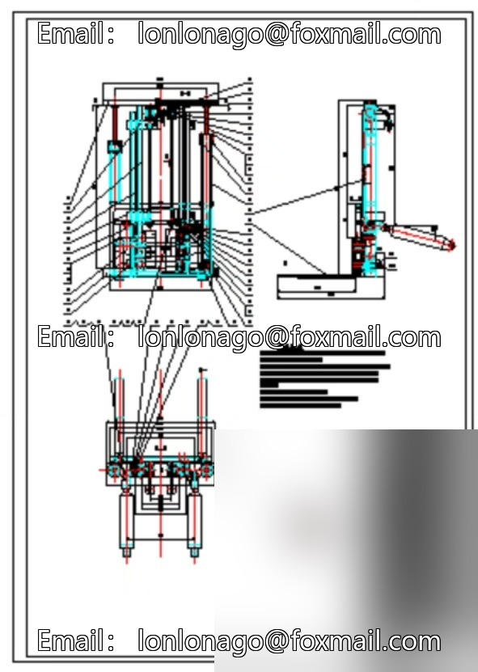
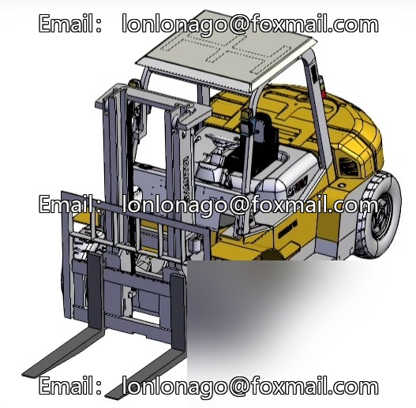

# Clamping frame design clamping frame design drawing clamping frame CAD drawing clamping frame three-dimensional

## Body

Crane gate frame design; Crane gate frame design drawing; Crane gate frame CAD drawing; Crane gate frame three-dimensional drawing; Crane gate frame three-dimensional drawing 3D
Crane gate frame system structural design; Crane gate frame system optimization design
This material contains instructions (involving optimization design of the crane gate frame, first carrying out design calculation on the forklift side handlebar, then carrying out detailed design calculation on the frame and internal and external gate frames, wheel component calculation, and finally analyzing stress and deformation after applying constraints and loads on a 5t crane gate frame through finite element analysis software) + 2D figures (3 pieces) + 3D models
515

The material includes cross-door frame design diagrams, CAD diagrams, three-dimensional models, system structural design and optimization design, along with a description covering the optimization design process.

<!-- AI_ENRICHED -->

## Images

## Payment

Here is a pay link on Stripe ( https://buy.stripe.com/3cs8yP7sY87d0vu9AB ). Please contact me lonlonago@foxmail.com after funding $89, and I will send you a complete data files , thank you!

